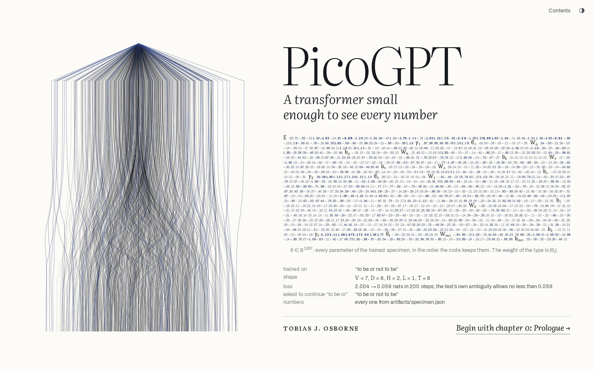
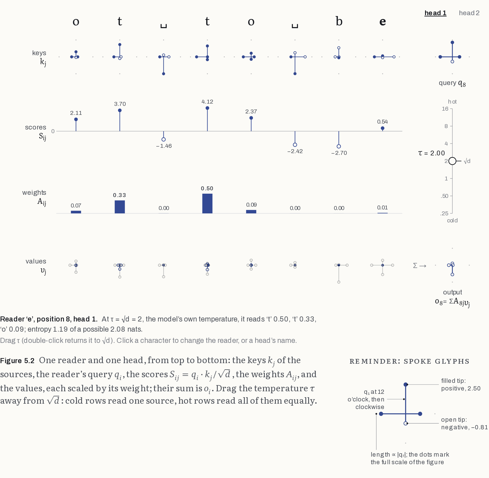
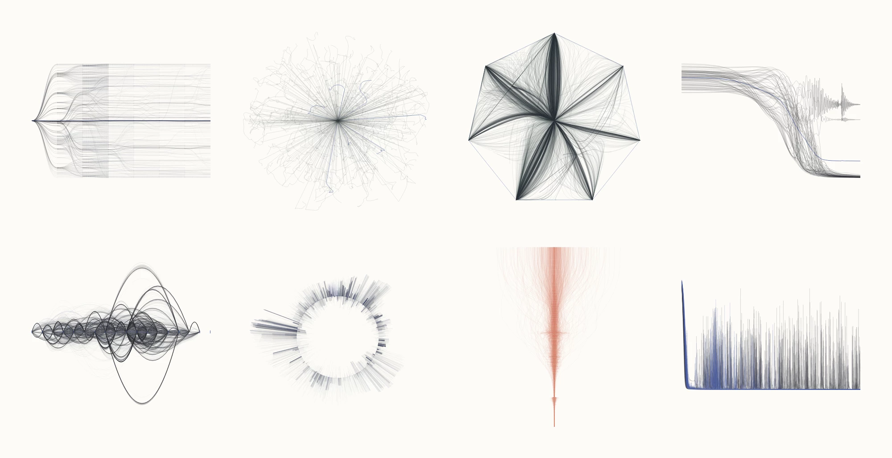
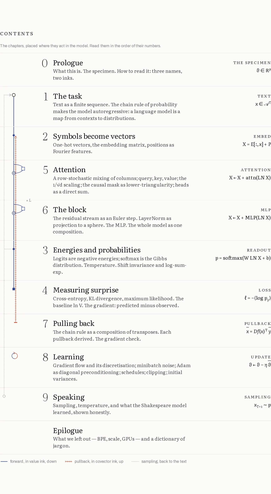
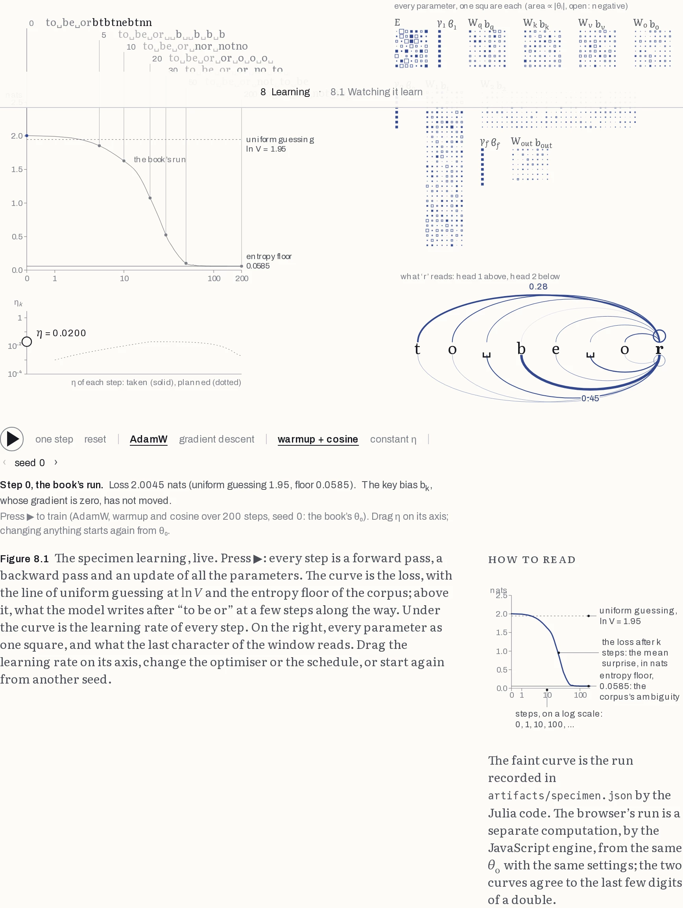

<p align="center">
  <a href="https://tobiasosborne.github.io/PicoGPT.jl/">
    
  </a>
</p>

<h3 align="center">
  <a href="https://tobiasosborne.github.io/PicoGPT.jl/">Read the book</a>
  &nbsp;·&nbsp;
  <a href="https://tobiasosborne.github.io/PicoGPT.jl/contents/">Contents</a>
  &nbsp;·&nbsp;
  <a href="#the-code">The code</a>
  &nbsp;·&nbsp;
  <a href="#the-print-edition">The print edition</a>
</h3>

<br>

A GPT, written from scratch in Julia, and a book about it. The book is meant for students of
physics and mathematics.

The mathematics of a transformer is easy: linear algebra, the chain rule, and a little
probability. The difficulty is the vocabulary and the habits of the field. This book removes
that difficulty. Every object is a map between named spaces, every term of jargon is defined in
language the reader already owns, and every number on every page comes from a real model.

The model is the **specimen**. It was trained on one line of text, `to be or not to be`, and
it has exactly **1007 parameters**, few enough to see every one of them. It runs live in your
browser. Press ▶ in Chapter 8 and you can watch it learn: the loss falls to the floor that the
text's own ambiguity allows, which is exactly (2 ln 2 + 3 ln 3)/80 nats, and the output turns
from `to␣be␣orbtbtnebtnn` into `to␣be␣or␣not␣to␣be`.

## Three names, two inks

> *Any respectable object has at least three names.*

Each concept is introduced by its name in mathematics, in physics, and in machine learning:

| maths | physics | ML |
|---|---|---|
| a probability vector p = softmax(z) | the Gibbs distribution | "softmax output" |
| a row-stochastic, lower-triangular matrix | a causal transition kernel | "attention weights" |
| the adjoint x̄ = Df(x)ᵀ ȳ | a pullback | "backprop" |

The whole book rests on one idea, drawn in two inks:

> A transformer is a composition of maps. Running it pushes values forward; training pulls
> one number, the loss, back through the transposed derivatives.

<p align="center">
  
</p>

Value ink, in indigo, marks the things the model computes. Covector ink, in vermilion, marks
the things training pulls back. Each glyph is introduced once with a *how to read* key, and is
then used small and often.

## Traces

Every chapter opens with a **trace**: a plotter-style drawing in which every stroke is a path
that a real computation took. Nothing in them is drawn by hand. Each file is stroke-only SVG at
print size, so it could be sent to a pen plotter.

<p align="center">
  
</p>

From left to right, top to bottom:
- **The chain rule:** a tree of probabilities that collapses onto the one true text.
- **Embeddings:** the vectors burst from their starting points, in 64 independent runs.
- **Softmax:** the Gibbs distribution sweeps from the centre of the simplex to its corners as
  the temperature falls.
- **Surprise:** the 80 predictions settle onto plateaux at exactly ln 2 and ln 3.
- **Attention:** every reading the two heads made while learning.
- **LayerNorm:** columns drawn onto a sphere that is never itself drawn.
- **Pulling back:** the gradient, dying away to nothing.
- **Learning:** Adam's slingshot, seen across 120 random seeds.

The source is in `tools/traces/`.

## Contents

<p align="center">
  
</p>

| | | |
|---|---|---|
| 0 | [Prologue](https://tobiasosborne.github.io/PicoGPT.jl/prologue/) | The specimen; how to read this book |
| 1 | [The task](https://tobiasosborne.github.io/PicoGPT.jl/task/) | Text as a sequence; the chain rule of probability |
| 2 | [Symbols become vectors](https://tobiasosborne.github.io/PicoGPT.jl/vectors/) | One-hot vectors, embeddings, positions as rotations |
| 3 | [Energies and probabilities](https://tobiasosborne.github.io/PicoGPT.jl/energies/) | Logits are negative energies; softmax is the Gibbs distribution |
| 4 | [Measuring surprise](https://tobiasosborne.github.io/PicoGPT.jl/surprise/) | Cross-entropy, KL divergence, and the floor no model can beat |
| 5 | [Attention](https://tobiasosborne.github.io/PicoGPT.jl/attention/) | The one map through which positions talk |
| 6 | [The block](https://tobiasosborne.github.io/PicoGPT.jl/block/) | Euler steps on a residual stream; LayerNorm as a sphere |
| 7 | [Pulling back](https://tobiasosborne.github.io/PicoGPT.jl/pulling-back/) | The chain rule as a composition of transposes |
| 8 | [Learning](https://tobiasosborne.github.io/PicoGPT.jl/learning/) | Gradient flow, Adam, schedules, and a model that trains in your browser |
| 9 | [Speaking](https://tobiasosborne.github.io/PicoGPT.jl/speaking/) | Sampling, temperature, and what the Shakespeare model really learned |
| | [Epilogue](https://tobiasosborne.github.io/PicoGPT.jl/epilogue/) | What we left out, and a dictionary of jargon |

<p align="center">
  
</p>

## The code

The code is written to be read beside the book: it is pure Julia with no dependencies beyond the
standard library and **no automatic differentiation**. Every operation returns its value and its
*pullback*, the adjoint of its derivative. The backward pass is the forward pass read in reverse.
All parameters live in one vector θ ∈ ℝᵖ, and the named parameters are views into it. The files
follow the chapters.

```julia
function attention(Q, K, H, T)
    D, N = size(Q)
    A = similar(Q, T, T, H, N ÷ T)
    α = 1 / √eltype(Q)(D ÷ H)                             # 1/√d, in the number type of Q
    M = eltype(Q)[j > i ? -Inf : 0 for i in 1:T, j in 1:T]     # the causal mask
    foreach_head(A, Q, K) do a, q, k
        mul!(a, q', k, α, false)                          # S = qᵀk/√d
        softmax!(a .+= M; dims = 2)                       # A = softmax_rows(S + M)
    end
    function back(Ā)
        S̄, Q̄, K̄ = similar(A), similar(Q), similar(K)
        foreach_head(A, Ā, S̄, Q, K, Q̄, K̄) do a, ā, s̄, q, k, q̄, k̄
            s̄ .= a .* ā                                    # S̄ = A ⊙ Ā …
            s̄ .-= a .* sum(s̄, dims = 2)                   # … − A ⊙ (row sums of A ⊙ Ā)
            mul!(q̄, k, s̄', α, false)                     # Q̄ = k S̄ᵀ/√d
            mul!(k̄, q, s̄, α, false)                      # K̄ = q S̄ /√d
        end
        Q̄, K̄
    end
    A, back
end
```

```sh
julia --project -t auto -e 'using Pkg; Pkg.test()'      # 710 tests, including a gradient check of every pullback
julia --project -t auto scripts/train_shakespeare.jl     # train on Tiny Shakespeare (Float32, threaded)
julia --project scripts/export_specimen.jl               # the specimen, every intermediate value, as JSON
```

The browser runs a zero-dependency JavaScript twin of the model, in `web/src/specimen`. It
agrees with the Julia to about 10⁻¹⁵ on every forward array and gradient, and to 10⁻¹³ along a
whole training run. A full training step of the specimen takes about a third of a millisecond.

## The print edition

The same HTML, set as a printed book: 189 × 246 mm, an outer column for notes, figures in their
static states, and the traces as plates facing each chapter opening. It is paginated by
Paged.js and printed to PDF by headless Chromium, so there is no second typesetting system.

```sh
cd print && npm install && npm run pdf                   # → print/PicoGPT.pdf
```

## Build the web book

```sh
cd web && npm install && npm run dev                     # needs pandoc ≥ 3 on the PATH
```

The prose is in `book/chapters/*.md`, one source for both web and print. The visual system is
described in [`DESIGN.md`](DESIGN.md) and the binding specification in [`BRIEF.md`](BRIEF.md).
The verified mathematics is in [`book/notes/derivations.md`](book/notes/derivations.md).

## Acknowledgements

The tone owes a debt to Olaf Hohm's *Lecture Notes on Statistical Physics and Neural Networks*
(arXiv:2605.06394). The information design owes one to Federica Fragapane, whose glyphs are
proof that every mark can be a number and still be beautiful. The architecture is GPT-2's,
simplified: sinusoidal positions and ReLU.

Apache License 2.0.
